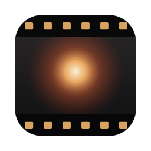

<p align="center">
  
</p>

<h1 align="center">Emulist</h1>

<p align="center">
  <b>Digital footage. Analog soul.</b><br>
  A native, open-source film emulation and color grading app for LOG footage on the Mac.
</p>

<p align="center">
  <a href="https://github.com/Dilantha-Wijesinghe/emulist/actions/workflows/ci.yml"></a>
  <a href="https://github.com/Dilantha-Wijesinghe/emulist/releases/latest"></a>
  
  <a href="LICENSE"></a>
</p>

---

Drop in a clip shot in Apple Log (or S-Log3, V-Log, F-Log), pick a film, refine it, and export. Emulist models
film the way it works, a negative printed onto paper, with grain, halation and bloom, and grades *under* the look
like a colorist works under a LUT in DaVinci Resolve. It's written in Swift with SwiftUI and Metal, and renders a
UHD frame with every effect in about 13 ms.

## Features

- **Film looks.** Seven original stocks, each with its own negative and print response, plus Fujifilm's official
  film simulations (a free download from Fujifilm) and 14 Fuji X Weekly recipes built on them.
- **Real grading tools.** Lift, Gamma, Gain and Offset wheels, contrast, saturation, Color Boost, Density, printer
  lights and six hue vectors with Protect Skin.
- **Texture.** Grain in log exposure, halation from the red record, and bloom, all resolution independent.
- **Scopes.** Waveform, RGB parade and vectorscope, computed on the GPU from the picture on screen.
- **A looks library** rendered live on your own frame, with hover preview, search and favorites.
- **LUTs both ways.** Import any `.cube` LUT, or export your grade as one for Resolve and other apps.
- **Many clips.** Copy and paste grades, snapshots, saved looks, and batch export to ProRes, HEVC or H.264.

## Install

Download the latest `Emulist-*.dmg` from [Releases](https://github.com/Dilantha-Wijesinghe/emulist/releases/latest)
and drag Emulist to Applications. It needs macOS 14.2 or later on Apple silicon.

The app isn't notarized yet, so macOS blocks the first launch. Run this once, then open it as usual:

```sh
xattr -dr com.apple.quarantine /Applications/Emulist.app
```

### Build from source

Only the Swift toolchain is needed (Xcode, or just the Command Line Tools). Shaders compile at runtime.

```sh
git clone https://github.com/Dilantha-Wijesinghe/emulist.git && cd emulist
scripts/build-app.sh --open      # builds build/Emulist.app (release) and launches it
scripts/test.sh                  # unit tests (Swift Testing)
```

## Using it

The window is laid out like Resolve's color page: looks on the left, the viewer in the middle, grading palettes
along the bottom.

1. **Drop footage** onto the window (or ⌘O), one clip or several. Apple Log is detected from the clip's metadata
   (including Blackmagic Camera's untagged iPhone clips). If a file doesn't declare its LOG curve, Emulist asks
   which profile it was shot in when you first open that clip.
2. **Pick a look** in the library. Every thumbnail is your current frame, rendered live. Emulist's own film stocks
   are there from the start; *Download from Fujifilm* adds Fujifilm's official film simulations (see below).
   Rest the pointer on a look to **preview** it in the viewer (and the scopes) without touching your grade; click
   to apply it. The eye button turns live preview off. **Search** narrows every collection by name. Right-click
   any look to add it to **Favorites**, which sit at the top with the last four looks you applied (**Recent**).
   Recipes are listed under the Fujifilm simulation each one builds on.
3. **Grade with the primaries** (bottom left), which work *under* the look like grading under a LUT in Resolve,
   so the film's curve keeps every correction graceful:
   - **Lift, Gamma, Gain, Offset wheels.** Drag anywhere on a wheel to move its puck toward a hue (relative and
     slow for precision; ⌥ finer, ⇧ faster). The ribbed thumbwheel underneath is the master level. Type exact
     R G B values in the readouts.
   - **Contrast & Pivot, Saturation, Color Boost** (lifts muted colors, spares already-vivid ones), **Density**
     (subtractive saturation: colors get deeper and richer, like denser dye; neutrals untouched), **Shadows**,
     **Highlights**, plus **Exposure, Temp, Tint** (applied as light, before everything).
   - **Hue** (the switch next to PRIMARIES swaps it in for the wheels): six vectors, red, yellow, green, cyan,
     blue and magenta, each with **Hue** (turns those colors toward the neighboring vector, up to 30°),
     **Sat** and **Density** (deeper color for that hue only), like Resolve's ColorSlice. Hues between two
     vectors blend smoothly, neutrals and luminance never change, and **Protect Skin** spares skin tones.
     They're baked into the look, so a drag previews on the coarser LUT like Intensity does.
4. **Shape the film** in the rack (bottom right): intensity, push/pull and fade; printer lights; grain, halation
   and bloom, each with its own power switch.
5. **Compare** with the two toolbar buttons: **Before / After** latches the ungraded image on and off (`B`), and **Split** shows a wipe you can drag (`⇧B`).
   To match shots, right-click another clip in the strip and choose **Compare with This Clip**: its graded frame
   (the one on its thumbnail) fills the left of the wipe, fitted inside the frame. Switching clips, `B`, `⇧B` or
   removing that clip ends the comparison.
   **Scopes** (the toolbar's scope button, or ⇧⌘K) open beside the viewer: a **waveform** or **RGB parade**
   (0–1023, like Resolve) above a **vectorscope** with 75% color bar targets and a skin-tone line. They read the
   picture exactly as the viewer shows it, a split or wipe included, so the parade's columns line up with the
   image. They're computed on the GPU from the frame on screen, and cost nothing while hidden.
   For more room, hide the looks library (⌘L), or press ⌘F for the **cinema viewer**: only the picture, full
   screen, with playback still on Space and the arrows. Esc brings everything back.
6. **Work across clips.** With two or more clips a strip appears under the viewer, with a live graded thumbnail
   per clip. Click a clip to grade it; each clip keeps its own grade and its own undo history.
   - **Copy Grade** (⌥⌘C) and **Paste Grade** (⌥⌘V). ⌘-click clips in the strip to pick several, and one paste
     reaches them all. **Paste Grade…** (⇧⌥⌘V) chooses which parts travel, with a switch for each group: Input
     (camera, exposure, white balance, off by default), Primaries, Look & Film, Printer Lights, Grain/Halation/Bloom
     and Output. Every pasted clip stays fully editable, and each paste is one undo step on its clip.
   - **Apply Grade to All Clips** copies the current clip's grade (the same groups) to every other clip.
7. **Snapshots** (the camera button, or ⌥⌘S) save the clip's grade at a moment. Hold the button for the clip's
   snapshots: restore one, save it as a look, or delete it.
8. **My Looks.** *Save Current Look…* (the + in the library, or Grade › Save Look…) stores the parts of a grade you
   choose. Saved looks appear at the top of the library, rendered live on your frame; click one to apply it.
   Right-click to rename or delete. They're kept in `~/Library/Application Support/Emulist/Presets`.
9. **Export** (⌘E) the current clip: ProRes 422 HQ, HEVC 10-bit or H.264, with audio. **Export All Clips…** (⇧⌘E,
   or *All Clips* in the export sheet) renders every clip with its own grade into a folder you choose, one after
   another, named "clip – look". A name that's taken gets " 2", " 3", so no file (the footage included) is ever
   replaced. Clips whose footage is missing are skipped and listed. Stop ends the current export and the rest.
10. **Save** the session as an `.emulist` project (⌘S): every clip, its grade and its snapshots. Saved projects
   autosave, an unsaved session asks before it's closed or the app quits, footage is never modified, and a clip whose footage moved waits to be relinked without blocking the
   others. Projects from earlier versions open as a single clip.

**Every control works the same way.** Drag it (or scroll over it on a trackpad); hold ⌥ for fine control. It
clicks into its default with a haptic detent on Force Touch trackpads. Double-click to reset, or click the value
to type one. Each drag or scroll burst is one undo step.

| Shortcut | Action |
|---|---|
| Space | Play / pause |
| ← / → | Previous / next frame |
| B, ⇧B | Before / after, split compare |
| ⇧⌘K, ⌘L, ⌘F | Show scopes, hide the looks library, cinema viewer (Esc leaves it) |
| ⌘O, ⌘S, ⇧⌘S | Add clips or open a project, save, save as |
| ⌘E, ⇧⌘E | Export the current clip, export all clips |
| ⌘Z, ⇧⌘Z | Undo, redo for the current clip (each slider drag is one step) |
| ⌥⌘C, ⌥⌘V, ⇧⌥⌘V | Copy grade, paste grade, paste chosen parts |
| ⌥⌘S | Take a snapshot |
| ⌥⌘←, ⌥⌘→ | Previous / next clip |

### Output encoding

Both options show the same image in the viewer. They differ in which players reproduce it exactly:

- **Rec.709 · Apple Devices** (default). Apple's video stack (QuickTime, Photos, Safari, iPhone) decodes
  Rec.709 video with an effective gamma of about 1.961. Emulist encodes for that, so your export looks like the viewer
  on Apple screens.
- **Rec.709 · Gamma 2.4**. This is the broadcast and DaVinci Resolve convention. It looks lighter in QuickTime.

## The film looks

| Stock | Character |
|---|---|
| Solstice 400 | Warm, soft color negative. Honest skin, golden highlights, open shadows. |
| Nocturne 800 | Cinema negative on print. Teal shadows, dense warm mids, restrained color. |
| Aurora 50 | Clean daylight cinema stock. Fine grain, natural and rich. |
| Golden 200 | Nostalgic consumer film. Buttery yellows and warm blacks. |
| Verdant 200 | Cool everyday film. Emerald greens and clean skin. |
| Chrome 100 | Slide film. Deep blacks, vivid separation. |
| Silver 400 | Panchromatic black and white on a faintly warm paper. |

These are original creative interpretations, not measurements of commercial stocks. A stock is plain data
(`FilmStock` is `Codable`), so adding one is a new entry in `BuiltInStocks.swift`. No UI code changes.

### Fujifilm film simulations

*Download from Fujifilm* in the library (or `emulist-cli install-fujifilm`) fetches Fujifilm's free official
LUT package (GFX ETERNA 55, 46 MB) from fujifilm-x.com. It installs the ten F-Log2 film simulations: Provia,
Velvia, Astia, Classic Chrome, Reala Ace, Pro Neg. Std, Classic Neg., Eterna, Eterna Bleach Bypass and Acros.
They land in `~/Library/Application Support/Emulist/Looks/Fujifilm` and are never bundled with Emulist.

Your footage reaches them through a colorimetric bridge: camera LOG → scene-linear Rec.2020 (= F-Gamut) → F-Log2.
Each simulation then renders as Fujifilm designed it, with the primaries, grain, halation and bloom still
applied around it. Only colors at the very edge of F-Gamut, or pushed beyond it by the grade, are first rolled
softly back inside, so the LUT never clips them flat. Intensity blends the simulation with Emulist's neutral print. Very high
saturation on an already-vivid look (e.g. Velvia at 200%) makes blotches appear in skies and flat walls: those are
the camera codec's chroma blocks in the footage, faint at 100% and amplified by saturation, not clipping.

### Fuji X Weekly recipes

With the Fujifilm simulations installed, a **Fuji X Weekly Recipes** collection appears below them: 14 popular
in-camera recipes from [fujixweekly.com](https://fujixweekly.com) (Kodak Gold 200, Portra 400 v2, CineStill 800T,
Kodak Tri-X 400 and more), each on its Fujifilm simulation. Click one to apply it; right-click for its recipe page.
A recipe sets the look, primaries, printer lights and grain, and never the clip's own exposure or white balance.
They're approximations, since recipes are tuned for in-camera JPEGs:

| Fujifilm setting | Emulist |
|---|---|
| WB shift R / B | Cyan·Red / Yel·Blue, 6 per step |
| Highlight | Highlights, +15 per step |
| Shadow | Shadows, −15 per step (on Fujifilm, + darkens shadows) |
| Color | Saturation, 100 % + 8 % per step |
| Color Chrome Effect Weak / Strong | Density 25 / 50 |
| Color Chrome FX Blue Weak / Strong | Blue vector Density 25 / 50 |
| Grain Weak / Strong, Small / Large | Amount 20 / 40, Size 25 / 55 (Off turns grain off) |
| DR200 / DR400 (D-Range Priority Strong) | Highlights −10 / −20 (−20 and Shadows +15) |

Clarity isn't modeled yet; a recipe's tooltip says so when it uses it. Recipes are
data (`FujiXWeeklyRecipes.swift`), so adding one is a new entry. `emulist-cli render … --recipe "<name>"` renders
one, and `sheet --collection Fuji` renders the simulations and recipes together.

### Exporting a look as a LUT

**Grade › Export Look as .cube…** (or *Export as .cube…* on a saved look or a recipe) bakes the grade into a 3D
LUT for other apps, such as DaVinci Resolve. Choose the footage it takes (Apple Log by default, or any camera
profile), the output (Rec.709 · Gamma 2.4 is what Resolve expects) and a 33- or 65-point grid. Every grid point
runs through the same pipeline as the viewer, with the clip's exposure and white balance left out, so the LUT
carries the look: film, primaries, printer lights and fade. Grain, halation and bloom work across neighboring
pixels, so no LUT can carry them. On a 65 grid the LUT stays within half a code of Emulist on average; saturated
colors through a steep look can differ by a few codes, as with any LUT. `emulist-cli cube <out.cube>` does the
same from the command line.

### Your own LUTs

Import any 3D `.cube` LUT with **+** in the library, or drop it on the window. Emulist reads the LUT's expected
input from its name: `F-Log2`, `F-Log`, `S-Log3` or `V-Log`, and otherwise Apple Log. It treats the LUT's output
as Rec.709 for a gamma 2.4 display, which is the convention for camera and creative LUTs. Imported LUTs live in
`…/Emulist/Looks/Imported`.

## How it works

The color math (camera decode, film model, primary grade, hue vectors) is plain Swift with unit tests. It's baked
into lookup tables the GPU samples, except the primary grade, which also runs in a shader so grading never waits
for a rebake. [docs/ARCHITECTURE.md](docs/ARCHITECTURE.md) walks through the pipeline, the film model and the
code, and [docs/adr](docs/adr) records the larger decisions.

## Contributing

Contributions are welcome. [CONTRIBUTING.md](CONTRIBUTING.md) covers the setup, the ground rules and
`emulist-cli`, the headless renderer used for look development. Please report security issues privately (see
[SECURITY.md](SECURITY.md)).

## Roadmap

- Custom user stocks (JSON)
- Curves and qualifiers
- Gate weave, film breath and dust
- Canon Log 3
- Apple Log 2, once Apple publishes it

## License

Emulist is released under the [MIT License](LICENSE).

Emulist is an independent project, not affiliated with or endorsed by Fujifilm, Fuji X Weekly, Kodak, CineStill,
Apple, Sony, Panasonic or Blackmagic Design (DaVinci Resolve). Their names appear only to describe
compatibility and to credit the recipes; all trademarks belong to their owners. Fujifilm's LUTs are downloaded from
Fujifilm on your request and are subject to Fujifilm's terms; they are not distributed with Emulist.
